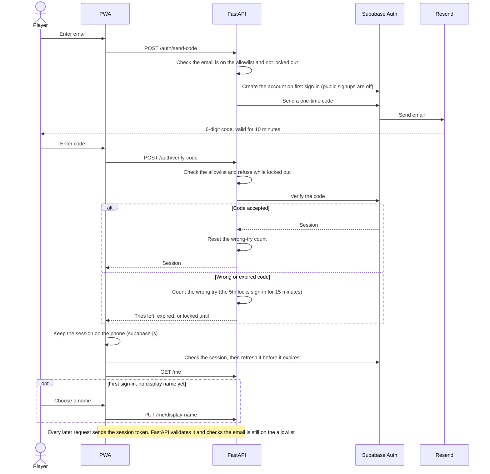
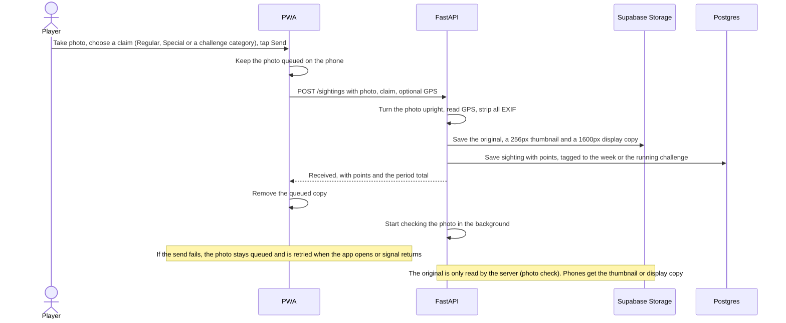
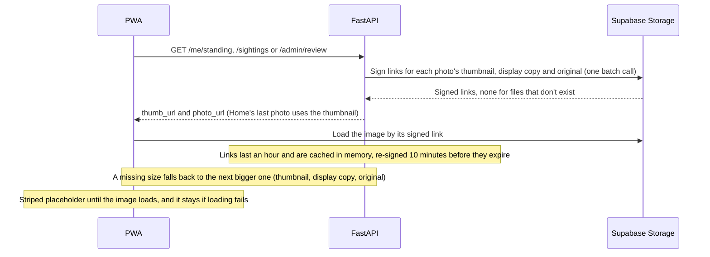
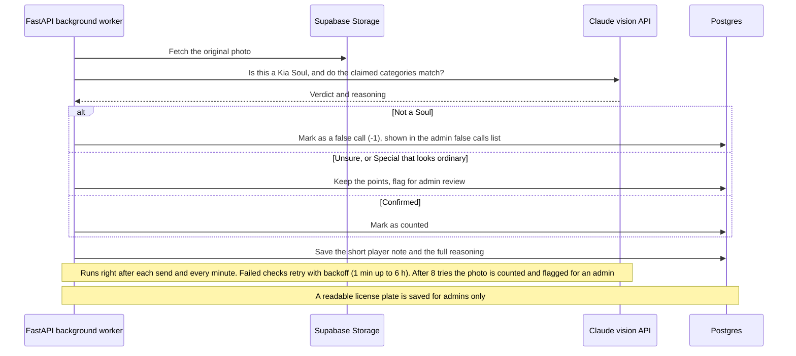
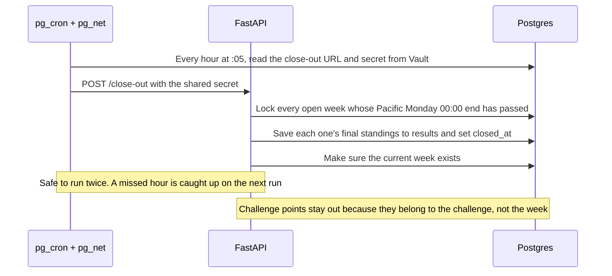

# Architecture

Soul Search is an installable phone web app (PWA) for iPhone and Android backed by a FastAPI service and Supabase. The PWA talks to FastAPI for everything except keeping its session fresh, which supabase-js does directly with Supabase Auth, and loading photos, which it fetches straight from Supabase Storage through short-lived signed links that FastAPI hands out. FastAPI is the only part that reads and writes data and talks to the Claude vision API.

Built so far: sign-in, both deploys, photo capture with an offline send queue, scoring, the weekly leaderboard and past weeks, the sightings log, background photo verification, the weekly close-out, timed challenges and the upcoming challenges list, and the admin tools (allowed emails, flagged photo review, challenges, point values, score adjustments and change history). Each issue that lands updates this page.

## System

## Flows

### Email-code login

### Photo send

### Viewing photos

The `python -m app.sightings.backfill_sizes` command creates missing sizes for older photos (see the README).

### Background verification

### Weekly close-out

## Environments

| Environment | Web | API | Supabase |
| --- | --- | --- | --- |
| Local | Vite on `localhost:5173` | FastAPI on `localhost:8000` | Supabase CLI stack in Docker, with Mailpit catching sign-in emails |
| Pull request previews | Netlify deploy preview for each pull request | Production API (allowed through `CORS_ORIGIN_REGEX`) | Production Supabase project |
| Production | Netlify (`soulsearch.cc`), deployed from `main` | Render, deployed from `main` once CI passes | Production Supabase project |

On every push to `main`, after the checks pass, the CI `migrate` job applies new migrations to the production database with `supabase db push`; Render waits for it, so the schema is in place before the API code that needs it. A separate staging environment (#18) is postponed and not needed for the MVP.
