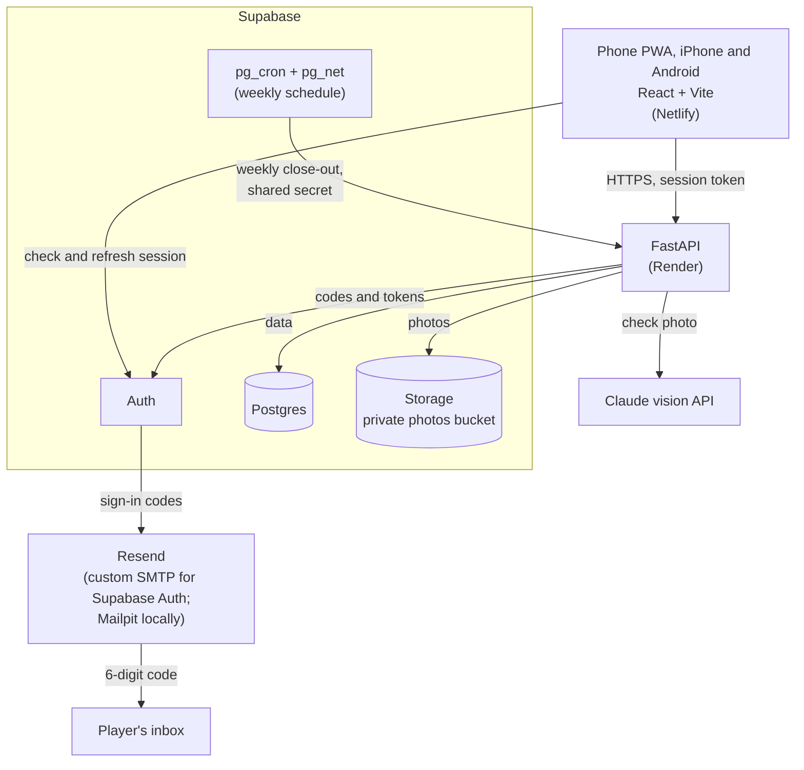
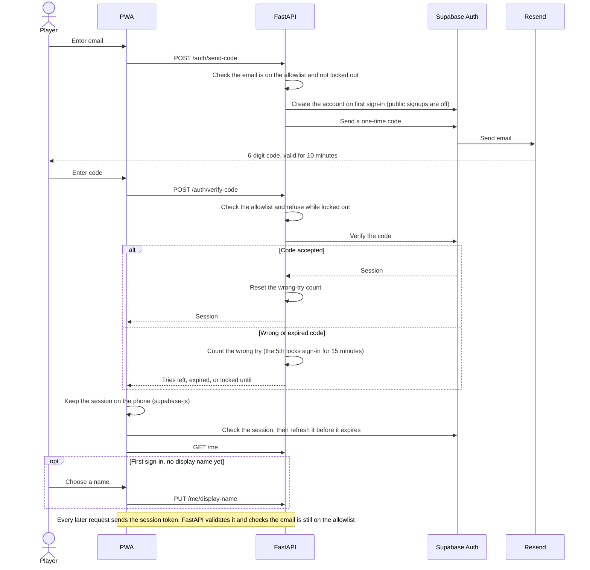
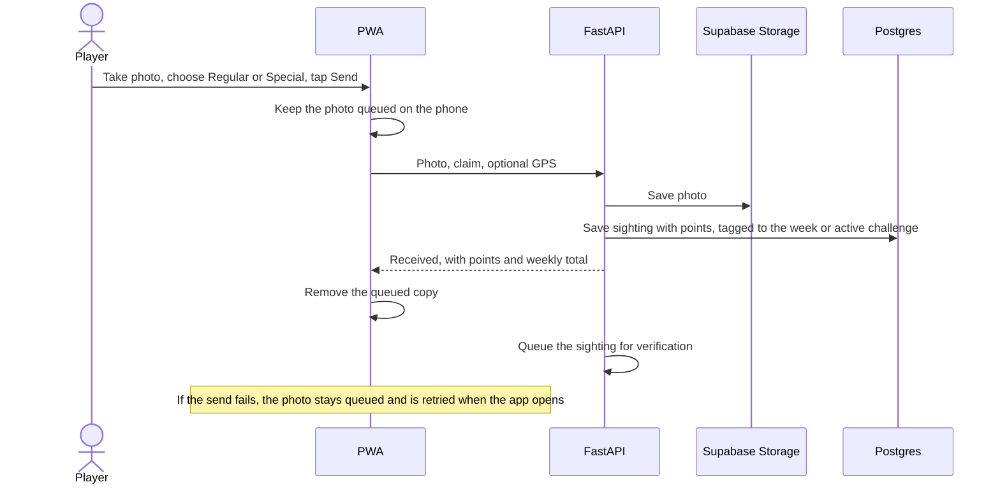
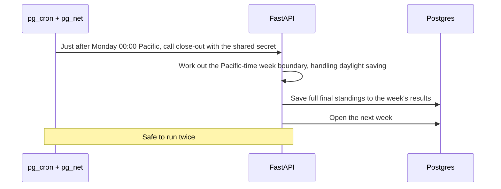

# Architecture

Soul Search is an installable phone web app (PWA) for iPhone and Android backed by a FastAPI service and Supabase. The PWA talks to FastAPI for everything except keeping its session fresh, which supabase-js does directly with Supabase Auth. FastAPI is the only part that reads and writes data and talks to the Claude vision API.

Sign-in, the database schema, both deploys, photo capture, scoring, the leaderboard and background photo verification are built; the weekly close-out is still planned. Each issue that lands updates this page.

## System



## Flows

### Email-code login



### Photo send



### Background verification

```mermaid
sequenceDiagram
    participant api as FastAPI background worker
    participant storage as Supabase Storage
    participant claude as Claude vision API
    participant db as Postgres

    api->>storage: Fetch photo
    api->>claude: Is this a Kia Soul, and do the claimed categories match?
    claude-->>api: Verdict and reasoning
    alt Not a Soul
        api->>db: Mark as a false call (-1), shown in the admin false calls list
    else Unsure, or Special that looks ordinary
        api->>db: Keep the points, flag for admin review
    else Confirmed
        api->>db: Mark as counted
    end
    api->>db: Save the short player note and the full reasoning
    Note over api,claude: Runs right after each send and every minute. Failed checks retry with backoff (1 min up to 6 h); after 8 tries the photo is counted and flagged for an admin
    Note over api,db: A readable license plate is saved for admins only
```

### Weekly close-out



## Environments

| Environment | Web | API | Supabase |
| --- | --- | --- | --- |
| Local | Vite on `localhost:5173` | FastAPI on `localhost:8000` | Supabase CLI stack in Docker, with Mailpit catching sign-in emails |
| Staging | Netlify branch deploy | Staging service deployed from a `staging` branch | Separate Supabase project with a test email sender |
| Production | Netlify, deployed from `main` | Render, deployed from `main` once CI passes | Production Supabase project |

Staging is planned in #18. Changes go to staging first, are verified there, then are promoted to `main`.
